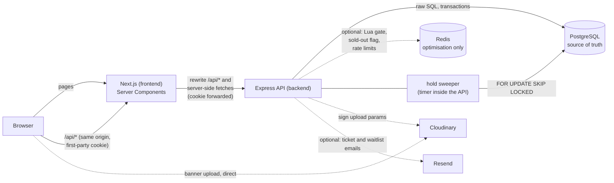

# SeatLock

An event platform for college societies whose registration backend **never oversells**.

> The invariant: for every event, `count(bookings WHERE status IN ('HELD','CONFIRMED')) <= events.capacity`, at every instant,
> no matter how many people click "Register" at the same moment, how many API servers run, or whether Redis is up.

It is enforced in three layers, so no single bug can break it: the seat is taken by **one conditional `UPDATE`** (the check and the
decrement are one statement), the database has a `CHECK (seats_left >= 0 AND seats_left <= capacity)` as the last line of defence,
and a **partial unique index** stops one person holding two seats. Redis sits *in front* as a speed-up only; it can make an
answer wrong in the safe direction ("sold out" too early) but cannot cause an oversell.

- What was measured and what was not: [docs/RESULTS.md](docs/RESULTS.md)
- Why each design decision was made: [docs/DESIGN.md](docs/DESIGN.md)
- Interview preparation (walkthrough, 40 Q&As, pitch, demo script): [INTERVIEW.md](INTERVIEW.md)

## The idea in plain words

College societies run events (hackathons, workshops, talks) with a limited number of seats. The usual tools are a Google Form or a
spreadsheet, and they break in the same ways: when everyone clicks at 6 pm the form accepts more people than there are seats, the
same person signs up twice, nobody knows who actually showed up, and cancelled seats are never given to the people waiting.

SeatLock is a registration site where **the seat is a real, counted thing in the database**, and the rules about it are enforced by
the database itself, not by hope. A student picks an event, gets a seat held for a few minutes while they fill the registration
form, confirms, and receives a signed QR ticket. At the gate a volunteer scans it with a phone camera and the person is marked
present. Every step in between (cancel, wait, waitlist, check-in) keeps the same promise: **the number of people holding a seat can
never be more than the capacity**.

### What is "holding" the seat?

A seat is held by a **row in the `bookings` table with `status = 'HELD'`**, plus a **countdown on that row** (`hold_expires_at`).
Nothing is held in the browser, in memory or in Redis. Concretely, one click on "Register" does this inside a single database transaction:

1. `UPDATE events SET seats_left = seats_left - 1 WHERE id = ? AND seats_left > 0 AND ...`. The check ("is a seat left?") and the take
   ("subtract one") are the same statement. Postgres locks the event row for the duration, so if 500 people click at the same instant they
   are served one by one, and the request that finds `seats_left = 0` matches zero rows and is told "sold out". This is why it cannot oversell.
2. `INSERT INTO bookings (... status 'HELD', hold_expires_at = now() + hold_minutes ...)`. This row records **who** holds the seat.
   A unique index allows one active booking per person per event. If the insert fails, the transaction rolls back and the decrement
   disappears with it, so a seat is never lost either.

The seat then goes one of three ways. The person **confirms** in time (`HELD` becomes `CONFIRMED`, the QR ticket appears). They
**cancel**, or **let the timer run out**: a background sweeper finds expired holds (`FOR UPDATE SKIP LOCKED`, so several servers never
fight over a row), marks them `EXPIRED` and gives the seat back, and the first person on the waitlist is offered it. The countdown
uses the database clock, never the browser's, so a wrong phone clock cannot extend a hold.

So the short answer: *a seat is held by a booking row and its expiry time, and `events.seats_left` is the counter that row paid for.*

### What makes it different (the USP)

- **Correct under a rush, by construction.** One atomic statement plus database constraints and a unique index, not "check, then
  write" in application code. The repository ships a runnable proof: `npm run race-demo` fires hundreds of simultaneous requests at a
  naive implementation (it oversells) and at the real one (it books exactly the capacity). The same demo, a **Chaos Lab** with
  failure injection, and an **integrity checker** that re-derives every counter from the raw rows are available in the organizer portal.
- **Honest holds instead of a race to the form.** The seat is reserved while the person fills in the registration questions, so
  nobody completes a long form only to be told it is full; and abandoned holds return to the pool by themselves.
- **A waitlist that runs itself.** When a seat frees up it is handed to the first person in line inside the same transaction.
- **Safe to retry.** Every hold carries an `Idempotency-Key`, so a double click or a retry after a flaky network returns the same
  booking instead of taking a second seat.
- **Tickets that cannot be forged.** The QR carries only a signed reference (HMAC), the server re-checks the live booking on every scan,
  and a real ticket works exactly once.
- **The whole event day, not only sign-up.** Organizers get custom questions, live seats, CSV export, volunteers and an admin above them;
  volunteers get a desk with a camera scanner and the registration sheet.
- **Honest about speed.** Redis is only a shortcut in front of Postgres. Turn it off and the answers stay correct, only slower
  under a rush. Measured and unmeasured numbers are separated in [docs/RESULTS.md](docs/RESULTS.md).

## Architecture



A booking's life: `HELD` (seat reserved for `hold_minutes`) → `CONFIRMED` (answers validated, QR ticket available) → checked in.
Holds that run out become `EXPIRED` and the seat returns; users can cancel `HELD` or `CONFIRMED` (not after check-in).
When an event is sold out people can join a **waitlist**; when a seat frees up (cancel, expired hold, capacity raised) it is handed to
the first person in line inside the same transaction, as a normal hold.

## The portals

| Portal | Who | Where | What they do |
|---|---|---|---|
| **User** | any signed-up person | `/`, `/e/<slug>`, `/me`, `/me/tickets/<id>` | browse events, register (seat held while they fill the form), join a waitlist, get a QR ticket, cancel |
| **Organizer** | role `organizer`, own sign-up and login at `/organizer/signup`, `/organizer/login` (an admin may log in there too) | `/organizer`, `/organizer/events/<id>` | create events with custom questions, publish, change capacity, see live seats and waitlist, registrations table, CSV export, add volunteers, cancel the event |
| **Volunteer desk** | a volunteer added to that event (also organizer and admin) | `/dashboard/events/<id>` (an "Open volunteer desk" banner shows on the event page), organizers scan at `/organizer/events/<id>/checkin` | open the camera and scan QR tickets (name, email and answers, checked in once; "Verify only" looks without checking in), see the registered people with their answers, search, and mark someone present by hand |
| **Account** | anyone logged in | `/account`, `/organizer/account` | click your name in the header: profile, password, theme, and Log out at the end |
| **Admin** | role `admin` | `/admin` | platform numbers, every organizer's events (with a Manage link), promote/demote users |

**What the QR contains.** The QR holds only a signed reference (booking id, event id, HMAC signature), not the person's data. The
scanner sends it to the server, which verifies the signature, checks the live booking, and returns the attendee's name, email and
registration answers. Putting the data in the QR itself would make it forgeable, stale after a cancellation, and leak personal data to
anyone who photographs a ticket.

## Repository layout

| Path | What it is |
|---|---|
| `backend/` | Express 5 API, raw `pg` SQL, optional Redis. `src/` code, `db/migrations/` schema, `scripts/` tools, `test/` integration tests |
| `frontend/` | Next.js (App Router, TypeScript, Tailwind) website |
| `docs/` | `DESIGN.md`, `RESULTS.md` and the raw load-test JSON |
| `docker-compose.yml` | Postgres 16 and Redis 7 for local development |
| `package.json`, `scripts/` | Shortcuts only (`setup`, `dev`, `test`, ...). Neither app depends on them |

## Run it locally

Needs Node 22+ and either Docker or a local Postgres 16. **Nothing external is required.** Redis, Cloudinary (banner uploads) and Resend (email) are all optional and simply switch off when not configured.

The two halves are independent programs. The website only talks to the API over HTTP (`API_URL` in `frontend/.env.local`); they share no code. The root `package.json` only holds shortcuts that call into each folder.

```bash
npm run db:up        # 1. Postgres + Redis in Docker (skip if you have your own Postgres; edit backend/.env instead)
npm run setup        # 2. install both apps and create backend/.env and frontend/.env.local from the examples (never overwrites)
npm run db:migrate   # 3. create the tables
npm run db:seed      # 4. admin, organizer, volunteer, students and six demo events
npm run dev          # 5. API on http://localhost:4000 and website on http://localhost:3000, in one terminal
```

Prefer two terminals? `npm run backend` and `npm run frontend`, or `cd backend && npm run dev` and `cd frontend && npm run dev`.
To run without Redis, leave `REDIS_URL=` empty in `backend/.env`; the app then uses Postgres only (slower under a sold-out rush, equally correct).

Open http://localhost:3000. Demo accounts (all use the password `password123`, except the admin):

| Role | Email | Notes |
|---|---|---|
| admin | `admin@seatlock.dev` / `admin12345` | from `ADMIN_EMAIL` / `ADMIN_PASSWORD` |
| organizer | `organizer@seatlock.dev` | owns both demo events |
| demo attendee | `demo@ipu.ac.in` | already has a confirmed ticket (HackIPU) and a seat on hold (Design Sprint) |
| organizers | `robotics@seatlock.dev`, `culture@seatlock.dev`, `startups@seatlock.dev` | Robotics Club, Cultural Committee, E-Cell |
| volunteer | `volunteer@seatlock.dev` | can scan tickets for HackIPU and the Rust workshop |
| students | `asha@ipu.ac.in`, `ravi@ggsipu.ac.in`, `meera@gmail.com` | the Rust workshop only accepts `ipu.ac.in` / `ggsipu.ac.in`, so Meera is refused there |

Demo events (15, each with a drawn poster from `frontend/public/posters`, regenerate with `node scripts/make-posters.mjs`): HackIPU 2026 (40 seats), Intro to Rust (25 seats, college emails only), a Design Sprint (online), Open Mic Night, an ML Study Jam (hybrid, college emails only), and a Robotics Demo Day whose registration has not opened yet.

### See the race (the 60-second proof)

```bash
cd backend && npm run race-demo -- --capacity 20 --requests 200
```

It fires 200 simultaneous requests at a 20-seat event, first with a naive "read, then write back" implementation and then with the
real one. The naive one books more than 20; the real one books exactly 20. The same demo is on the website at
`/organizer/lab` (log in on the organizer portal; needs `ENABLE_DEMO=true`).

### Tests

Tests use a **real** Postgres (never mocked) and real Redis (database 1). The Docker Postgres creates the `seatlock_test` database for you on first start (if you use your own Postgres, create one named `seatlock_test`). Then run:

```bash
npm test                                                          # 103 tests, ~50 s (needs Postgres and Redis running)
```

`TEST_DATABASE_URL` must contain "test" in its database name; the suite truncates every table and refuses to run otherwise.

## Scripts

All in `backend/` unless stated.

| Command | What it does |
|---|---|
| `npm run dev` / `npm start` | Start the API (watch mode / plain). Also starts the hold sweeper and, if `REDIS_URL` is set, the Redis reconciler |
| `npm run db:migrate` | Apply new files in `db/migrations/` (tracked in a `schema_migrations` table) |
| `npm run db:reset` | **Destroys** all data and re-migrates. Refuses `NODE_ENV=production` |
| `npm run db:seed` | Create or promote the admin from `ADMIN_EMAIL`/`ADMIN_PASSWORD` |
| `npm run db:seed:demo` | `db:seed` plus demo organizer, volunteer, students and six demo events |
| `npm run race-demo -- --capacity N --requests M` | Naive vs atomic race against your database |
| `npm run loadtest` | Load test of `POST /events/:id/hold`, Postgres-only vs Redis, 10 s per run (`LOADTEST_DURATION`, `LOADTEST_CONNECTIONS`). **Wipes** `TEST_DATABASE_URL` and Redis db 2 |
| `npm test` | The full integration suite |
| `web: npm run dev` / `build` / `start` / `typecheck` | Website (a `copy-wasm` step runs automatically, see below) |

## Environment variables

API (`backend/.env`, fully commented in `backend/.env.example`):

| Variable | Default | Meaning |
|---|---|---|
| `DATABASE_URL` | none (required) | Postgres connection string. On Neon use the **pooled** string |
| `TEST_DATABASE_URL` | none | Database used by `npm test` and `npm run loadtest`; name must contain `test` |
| `DB_POOL_MAX` | 20 | Connections per API process. Keep (instances x this) below the database limit |
| `JWT_SECRET` | none (required) | Signs login tokens. In production at least 32 chars and not the example value |
| `TICKET_SECRET` | none (required) | Signs QR tickets (HMAC-SHA256). Separate from `JWT_SECRET` |
| `TICKET_SECRET_PREVIOUS` | empty | Old ticket secret, accepted for verification only while rotating |
| `BCRYPT_COST` | 10 | bcrypt work factor |
| `TRUST_PROXY` | 0 | Number of reverse proxies in front (Render: 1) so rate limits see real client IPs |
| `ALLOWED_ORIGINS` | empty | Comma-separated website origins allowed to make cookie-authenticated writes (CSRF defence). Empty disables the check |
| `RATE_LIMIT_AUTH_PER_MIN` / `RATE_LIMIT_BOOKING_PER_MIN` | 20 / 30 | Per-IP on login/register, per-user on hold/confirm/cancel |
| `WEB_URL` | `http://localhost:3000` | Used for links inside `.ics` files and emails |
| `WAITLIST_HOLD_MINUTES` | 15 | Hold given to the first person on the waitlist when a seat frees up |
| `RESEND_API_KEY` / `MAIL_FROM` | empty | Optional email through [Resend](https://resend.com). Both must be set; without them no email is sent and the site works as before |
| `MAIL_API_URL` | Resend's URL | Only for tests (points at a fake provider) |
| `ADMIN_EMAIL` / `ADMIN_PASSWORD` | `admin@seatlock.dev` / `admin12345` | First admin, created by `db:seed` |
| `SWEEP_INTERVAL_SECONDS` | 30 | How often expired holds are released |
| `RECONCILE_INTERVAL_SECONDS` | 60 | How often Redis counters are compared with Postgres |
| `REDIS_URL` / `REDIS_ENABLED` | empty / true | Leave `REDIS_URL` empty (or `REDIS_ENABLED=false`) to run Postgres-only |
| `ENABLE_DEMO` | false | Mounts `/demo/*`. The API **refuses to start** with this on in production |
| `CLOUDINARY_CLOUD_NAME` / `_API_KEY` / `_API_SECRET` | empty | Optional banner uploads. Without them the site uses a typographic cover |
| `LOG_LEVEL` | info | `debug`, `info`, `warn`, `error`, `silent` |
| `PORT`, `NODE_ENV` | 4000, development | Standard |

Website (`frontend/.env.local`):

| Variable | Meaning |
|---|---|
| `API_URL` | Where the Next.js **server** reaches the API (used by the `/api/*` rewrite and Server Components) |
| `NEXT_PUBLIC_SITE_URL` | This site's public URL, used for absolute Open Graph image URLs and share links |

The QR scanner's decoder is a WebAssembly file. `npm run copy-wasm` (run automatically before `dev` and `build`) copies it into
`frontend/public/` so it is served from your own site instead of a public CDN, which keeps the gate scanner working on poor Wi-Fi.

## API reference

Errors always have the shape `{ "error": { "code": "SOLD_OUT", "message": "...", "details": {...} } }`.
Auth is an httpOnly cookie (`seatlock_token`); an `Authorization: Bearer <jwt>` header is also accepted.
IDs are returned as strings. "Organizer" means organizer or admin; organizers only see their own events (others get 404; admins see all).

| Method and path | Who | Success | Notable errors |
|---|---|---|---|
| `GET /health` | anyone | 200 `{status, postgres, redis}` | 503 if Postgres is down (Redis down is not fatal) |
| `GET /config` | anyone | 200 `{cloudinary_enabled, demo_enabled}` | |
| `POST /auth/register` | anyone | 201 sets cookie | 409 `EMAIL_TAKEN`, 422 `VALIDATION_FAILED`, 429 |
| `POST /auth/login` | anyone | 200 sets cookie | 401 `INVALID_CREDENTIALS`, 429 |
| `POST /auth/logout` | anyone | 200 | |
| `GET /auth/me` | logged in | 200 | 401 |
| `GET /public/events` | anyone | 200 published, upcoming events | |
| `GET /public/events/:slug` | anyone (optional login) | 200 event (+`waitlist_count`), `my_booking`, `my_waitlist` | 404 `EVENT_NOT_FOUND` |
| `GET /public/events/:slug/calendar.ics` | anyone | 200 calendar file | 404 |
| `POST /events/:id/hold` | logged in | 201 new hold, **200** replay of the same `Idempotency-Key` | 400 `IDEMPOTENCY_KEY_REQUIRED`, 403 `NOT_ELIGIBLE` / `REGISTRATION_NOT_OPEN` / `REGISTRATION_CLOSED` / `EVENT_CANCELLED`, 404, 409 `SOLD_OUT` / `ALREADY_REGISTERED`, 422 `IDEMPOTENCY_KEY_REUSED`, 429 |
| `POST /bookings/:id/confirm` `{answers}` | owner | 200 (also 200 on a retry) | 404, 409 `BOOKING_CANCELLED`, **410 `HOLD_EXPIRED`**, 422 `VALIDATION_FAILED` with `details.fields` |
| `POST /bookings/:id/cancel` | owner | 200 | 404, 409 `BOOKING_NOT_ACTIVE` / `ALREADY_CHECKED_IN` |
| `GET /me/bookings` | logged in | 200 | |
| `GET /bookings/:id` | owner | 200 incl. `hold_seconds_left` | 404 |
| `GET /bookings/:id/ticket` | owner | 200 `{token}` (signed QR payload) | 404, 409 `NOT_CONFIRMED` |
| `POST /events/:id/waitlist` | logged in | 200 `{waitlist:{position}}` (joining twice keeps your place) | 403 `NOT_ELIGIBLE` / `REGISTRATION_*` / `EVENT_CANCELLED`, 409 `SEATS_AVAILABLE` (register instead) / `ALREADY_REGISTERED`, 429 |
| `DELETE /events/:id/waitlist` | logged in | 204 | 404 `NOT_ON_WAITLIST` |
| `GET /me/waitlist` | logged in | 200 my places in line | |
| `POST /checkin` `{token, event_id?, preview?}` | organizer, admin, or volunteer **of that event** | 200 `{result:"OK" or "VALID", attendee, email, details:[{label,value}], registered_at,...}`; `preview:true` changes nothing | 400 `INVALID_TICKET` / `WRONG_EVENT`, 403 `NOT_STAFF`, 409 `ALREADY_CHECKED_IN` / `BOOKING_CANCELLED` / `NOT_CONFIRMED`, 404 |
| `GET /staff/events/:id/desk` | organizer, admin, or volunteer of that event | 200 `{event, stats:{confirmed, checked_in}}` | 404 (not staff) |
| `GET /staff/events/:id/registrations` | same | 200 registered people only, `after`/`limit`/`q` | 404 |
| `POST /staff/events/:id/registrations/:bookingId/present` | same | 200 marks present by hand | 404, 409 `ALREADY_CHECKED_IN` / `NOT_CONFIRMED` |
| `PATCH /auth/me`, `POST /auth/password` | logged in | 200 change name / password (also `/organizer/auth/...`) | 401, 422 |
| `GET /events` | organizer | 200 own events with counts | 401 |
| `POST /events` | organizer | 201 (slug generated) | 422 |
| `GET /events/:id` | owner/admin | 200 | 404 |
| `PATCH /events/:id` | owner/admin | 200 (draft or published) | 409 `EVENT_NOT_EDITABLE` / `QUESTIONS_LOCKED`, 422 |
| `POST /events/:id/publish` | owner/admin | 200 | 409 `INVALID_STATE`, 422 `INCOMPLETE_EVENT` |
| `PATCH /events/:id/capacity` | owner/admin | 200 | 409 `CAPACITY_CONFLICT` (below active bookings) / `EVENT_NOT_EDITABLE` |
| `POST /events/:id/cancel` | owner/admin | 200, cancels all active bookings | 409 `INVALID_STATE` |
| `POST /events/:id/complete` | owner/admin | 200 | 409 `INVALID_STATE` |
| `DELETE /events/:id` | owner/admin | 204 (drafts only) | 409 `INVALID_STATE` |
| `GET /events/:id/stats` | owner/admin | 200 (includes `waitlist`) | 404 |
| GET | `/events/:id/integrity` | organizer (owner) / admin | 200, 401, 403, 404 | Re-derives the seat numbers and reports each rule as pass/fail |
| `GET /events/:id/registrations?after=&limit=&q=&status=` | owner/admin | 200 `{registrations, next_cursor}` (keyset) | 400 |
| `GET /events/:id/registrations.csv` | owner/admin | 200 streamed CSV | 404 |
| `GET /events/:id/audit?before=&limit=` | owner/admin | 200 `{entries, next_cursor}` | |
| `GET/POST /events/:id/staff`, `DELETE /events/:id/staff/:userId` | owner/admin | 200 / 201 or 200 / 204 | 404 `USER_NOT_FOUND` / `STAFF_NOT_FOUND` |
| `GET /me/staff-events` | logged in | 200 events I volunteer for | |
| `POST /uploads/sign` | organizer | 200 signed Cloudinary params | 404 when Cloudinary is not configured |
| `GET /admin/stats` | admin | 200 platform counts | 403 |
| `GET /admin/events?before=&limit=` | admin | 200 `{events, next_cursor}` (all organizers) | 403 |
| `GET /admin/users?q=&after=&limit=` | admin | 200 `{users, next_cursor}` | 403 |
| `PATCH /admin/users/:id/role` | admin | 200 | 409 `CANNOT_DEMOTE_SELF`, 404 |
| `POST /demo/events/:id/book-naive`, `POST /demo/race` | `ENABLE_DEMO=true` only | 201 / 200 | route does not exist (404) otherwise |

Every protected route returns 401 without a login and 403 with the wrong role. Every response carries an `X-Request-Id`, which
also appears in the logs.


## Chaos Lab and integrity check

Most event sites claim they never oversell. SeatLock lets you try to make it fail.

- **Chaos Lab** (organizer portal, **Race & Chaos Lab** page, needs `ENABLE_DEMO=true`): sends a crowd of real HTTP requests at a throwaway event while you switch on failures: double-click retries, a second browser tab, Redis dying mid-rush, waitlist promotions, cancellations, and holds timing out under the sweeper. Afterwards an independent checker re-derives every seat number from the raw bookings and reports each rule as pass or fail.
- **Sabotage switch**: swaps the real booking code for the deliberately broken read-then-write version. The verdict must turn red, which shows the checker is not rigged.
- **Integrity check** (any event, any time): the **Overview** tab of an event has a read-only button that runs the same checker on real data. API: `GET /events/:id/integrity` (organizer who owns it, or admin).
- Code: `backend/src/services/integrity.js` (the rules), `backend/src/services/chaos.js` (the experiment), `backend/test/chaos.test.js`.

## Deployment (Render + Neon + Upstash + Vercel)

> **Not executed.** This was written from those services' documentation and the app's configuration, but none of it was run
> during the build (the build environment had no access to those accounts). Treat it as a checklist, and expect to adjust.

1. **Neon (Postgres).** Create a project. Copy the **pooled** connection string (host contains `-pooler`). Add `?sslmode=require` if it is not there.
   Keep `DB_POOL_MAX` small (5 is plenty for a free tier), because every API instance holds that many connections open.
   Migrations are plain SQL; if the pooled string gives you trouble when migrating, run `db:migrate` once with Neon's direct (non-pooled) string. Not tested against Neon.
2. **Upstash (Redis), optional.** Create a Redis database and copy the `rediss://` URL into `REDIS_URL`. If you skip Redis,
   leave `REDIS_URL` empty: everything works, rushes are just heavier on Postgres.
3. **Resend (email), optional.** Create an account, verify a sending domain, create an API key. Set `RESEND_API_KEY` and `MAIL_FROM` on the API. Skip it and everything still works; people just see their ticket and waitlist hold on the website instead of in their inbox. Not tested against Resend itself (only against a local fake).
4. **Render (API).** New Web Service from the repo, root directory `backend`, build command `npm install`, start command
   `npm run db:migrate && npm start`. Set: `NODE_ENV=production`, `DATABASE_URL`, `REDIS_URL`, `JWT_SECRET` and `TICKET_SECRET`
   (two different 32+ byte random values: `node -e "console.log(require('crypto').randomBytes(32).toString('hex'))"`),
   `TRUST_PROXY=1`, `ALLOWED_ORIGINS=https://<your-site>.vercel.app`, `WEB_URL=https://<your-site>.vercel.app`, and optionally
   Cloudinary keys and `ADMIN_EMAIL`/`ADMIN_PASSWORD`. Do **not** set `ENABLE_DEMO` (the API refuses to boot with it in production).
   Then run `npm run db:seed` once (Render shell) to create the admin. Health check path: `/health`.
5. **Vercel (website).** Import the repo, root directory `frontend`. Set `API_URL=https://<your-api>.onrender.com` and
   `NEXT_PUBLIC_SITE_URL=https://<your-site>.vercel.app`. The browser only ever calls `/api/*` on the site itself; `frontend/next.config.ts`
   rewrites that to `API_URL`, which is why the login cookie is first-party and survives browsers that block third-party cookies.
   If you change `API_URL`, redeploy (rewrites are fixed at build time).

**Live deployment checklist (verified wiring: Vercel `/api/health` proxies to the Render API and reports Postgres `ok`).**

- Render `ALLOWED_ORIGINS` must contain the exact Vercel origin (`https://seat-lock-theta.vercel.app`, no trailing slash). A mismatch shows up as "Cross-site request refused." on any form.
- Migrations (including `005_poster_images.sql`, which enables uploaded event posters without Cloudinary) run automatically when the API starts.
- `TRUST_PROXY=1` on Render. Requests pass Vercel's rewrite first, so if rate limits ever look shared between users, check the `ip` field in the API request log and raise it to `2`.
- Run `npm run db:seed` once against the production database to load the demo events and accounts (organizer and attendee logins are printed by the script).
- Uploaded posters are stored in Postgres (max 5 MB, images are shrunk in the browser first, to stay under Vercel's request body limit).

Free-tier caveats you should expect:

- **Render free web services sleep** after about 15 minutes without traffic, and the first request afterwards takes tens of seconds
  (cold start). Fine for a demo, bad for registration day: use a paid instance or ping `/health` before the event.
- Render's free instances have **512 MB of RAM**. The API is light (streamed CSV keeps memory flat) but keep `DB_POOL_MAX` low and
  run a single instance. The hold sweeper runs inside the API process, so while the service is asleep, expired holds are not
  released until it wakes (the confirm endpoint still refuses expired holds, so correctness is unaffected, only seat availability).
- Neon free databases also suspend when idle and take a moment to wake. Upstash free has a daily command limit; a rush uses
  several commands per request, so check your plan before a big event.
- Vercel serverless functions have their own time limits. All seat-taking logic lives in the API, not on Vercel.

## What is deliberately not built

No payments (see DESIGN.md for how Razorpay would plug in), no virtual waiting room, no offline scanning, no multi-region setup. [INTERVIEW.md](INTERVIEW.md) has the honest "what it does not do yet" list.
